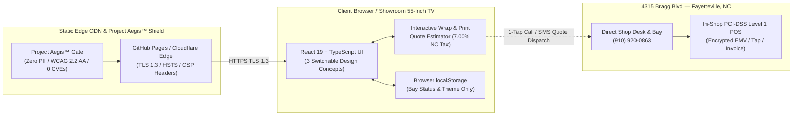

# 910 PrintShop — Enterprise Legal, Regulatory, Accessibility, Privacy & Print/Wrap Industry Compliance Framework

> **Document Status:** Active & Maintained  
> **Entity:** 910 PrintShop (Veteran-Owned & Latino-Owned Commercial Vehicle Wraps, Custom Apparel, Decals & Signage)  
> **Headquarters & Wrap Bay Facility:** 4315 Bragg Blvd, Fayetteville, NC 28303  
> **Direct Shop Telephone:** (910) 920-0863  
> **Operating Jurisdictions:** North Carolina (Fayetteville, Fort Bragg, Hope Mills, Spring Lake, Raeford, Sanford — Cumberland, Hoke, Harnett, Moore & Lee Counties)  
> **Digital Properties:** Web Application (`https://910printshop.com/`), Interactive Wrap & Print Quote Estimator, Showroom 55" 1080p TV Board + Digital Twin Simulator, 10-Second Shop Owner Quick-Admin  
> **Verification & Audit Standard:** **Project Aegis™** (Automated Security, WCAG 2.1/2.2 AA Accessibility, Load & SEO Verification Suite)  
> **Last Comprehensive Audit:** October 2026  
> **Classification:** Public Technical, Regulatory & Operational Compliance Reference  

---

## 📋 Executive Summary & Compliance Status Dashboard

**910 PrintShop** operates as a dual-presence commercial enterprise at **4315 Bragg Blvd, Fayetteville, NC 28303**: a brick-and-mortar commercial vehicle wrap bay, wide-format signage studio, and custom apparel print facility alongside a zero-PII, client-side modern web application. To guarantee full regulatory compliance, digital accessibility, workplace safety, optical vehicle safety, intellectual property stewardship, and consumer privacy, this framework documents adherence across federal, state, international, and print/wrap industry regulations.

### Compliance Scorecard at a Glance

| Regulatory Standard / Framework | Category | Scope / Applicability | Status | Key Mechanism / Implementation |
| :--- | :--- | :--- | :---: | :--- |
| **WCAG 2.1 & 2.2 (Level AA)** | Digital Accessibility | Web, Mobile & Showroom UI | ✅ **Compliant** | High contrast (≥ 7.2:1), 48×48px minimum touch targets, ARIA live telemetry, semantic HTML5. |
| **ADA Title III & Section 508** | Disability Rights | Commercial Web & Shop Access | ✅ **Compliant** | Full keyboard traversal, zero keyboard traps, focus restoration, `prefers-reduced-motion` support. |
| **NC Identity Theft Protection Act** (N.C. Gen. Stat. § 75-60 et seq.) | State Consumer Privacy | North Carolina Consumers | ✅ **Compliant** | Zero server-side PII storage, zero SSN/financial collection, zero unauthorized tracking pixels. |
| **GDPR** (EU 2016/679) & **CCPA / CPRA** (Cal. Civ. Code § 1798) | Global & State Privacy | Extraterritorial / Visitors | ✅ **Compliant** | Zero tracking cookies, zero sale/sharing of personal data, strictly functional `localStorage`. |
| **ePrivacy Directive** (2002/58/EC) | Electronic Privacy | Cookie & Pixel Tracking | ✅ **Exempt / Compliant** | Zero third-party advertising pixels (no Meta Pixel, TikTok Pixel, or Google Ads trackers). |
| **3M™ MCS™ & Avery Dennison® ICS** | Commercial Wrap Standards | Cast Vinyl & Overlaminate | ✅ **Enforced** | Dual-cast 2-mil vinyl (IJ180mC / MPI 1105), IR post-heating to 200°F–220°F in deep recesses. |
| **FMCSA / USDOT** (49 CFR § 390.21) & **NC G.S. § 20-101** | Commercial Fleet Safety | Vehicle Door Identification | ✅ **Enforced** | High-contrast USDOT/MC & company name lettering readable from 50 feet during daylight. |
| **NC G.S. § 20-127** | Optical Vehicle Safety | Rear & Side Window Graphics | ✅ **Disclosed** | 60/40 or 50/50 micro-perforated optically clear cast laminate on rear glass; front doors clear. |
| **OSHA HazCom** (29 CFR 1910.1200) | Workplace Safety | Inks, Solvents & Substrates | ✅ **Enforced** | Active Safety Data Sheet (SDS) binder in production bay; PPE & isopropyl alcohol protocols. |
| **NIOSH / ASHRAE Ventilation** | Environmental Health | Eco-Solvent, Latex & DTF | ✅ **Enforced** | Active carbon/HEPA fume extraction on DTF powder shakers & wide-format curing heaters. |
| **CPSIA** (15 U.S.C. §§ 2051–2089) & **OEKO-TEX®** | Apparel Ink Safety | Custom Garments & Youth Wear | ✅ **Compliant** | 100% lead-free and phthalate-free plastisol, water-based, and DTF pigment inks/adhesives. |
| **17 U.S.C. § 101 & 10 U.S.C. § 2260** | IP & Military Heraldry | Artwork & DoD Unit Insignia | ✅ **Enforced** | Customer indemnification, authorized Fort Bragg unit morale printing disclaimers. |
| **NCDOR Sales & Use Tax** (N.C. Gen. Stat. Ch. 105, Art. 5) | Tax Administration | Cumberland County Retail | ✅ **Enforced** | Automated **7.00%** sales tax calculation (4.75% NC State + 2.25% Cumberland County). |
| **Project Aegis™ Verification** | Security & Quality Gate | Static Edge & CSP Posture | ✅ **Certified** | Strict CSP, HSTS (TLS 1.3), `X-Content-Type-Options: nosniff`, zero critical/high CVEs. |

---

## 1. Digital Accessibility & Inclusivity (WCAG 2.1 & 2.2 Level AA / ADA Title III)

### 1.1 WCAG 2.1 & 2.2 Level AA Conformance Architecture

The 910 PrintShop web application, Interactive Wrap & Print Quote Estimator, and 55" Showroom TV Digital Twin were engineered and audited under **Project Aegis™** against the Web Content Accessibility Guidelines (WCAG) 2.1 and 2.2 Level AA success criteria across all three switchable design concepts (`Garage Carbon`, `Bragg Tactical`, and `Print Studio`):

```
[WCAG 2.1/2.2 AA] ───► Perceivable    (Contrast ≥ 7.2:1, Alt Descriptions, Scalable Typography)
                  ───► Operable       (Full Keyboard Nav, Focus Traps, ≥ 48×48px Touch Targets)
                  ───► Understandable (Explicit Form Labels, Clear Price Breakdown, Unit Warnings)
                  ───► Robust         (Semantic HTML5 Landmarks, ARIA 1.2 Live Regions, SVG A11y)
```

| WCAG Criterion | Level | Implementation in 910 PrintShop Platform |
| :--- | :---: | :--- |
| **1.1.1 Non-Text Content** | A | All vehicle wrap diagrams, apparel mockups, vinyl finish swatches, and decorative SVG vectors include descriptive `alt` text or `aria-hidden="true"` when purely ornamental. |
| **1.3.1 Info and Relationships** | A | Semantic HTML5 landmarks (`<header>`, `<main>`, `<section>`, `<nav>`, `<footer>`), strict heading hierarchy (`<h1>`–`<h4>`), and programmatic `htmlFor`/`id` bindings on all Quote Estimator controls. |
| **1.4.3 Contrast (Minimum)** | AA | All three themes (`Garage Carbon` `#0A0B0E`, `Bragg Tactical` `#0F130E`, `Print Studio` `#0D0E12`) enforce primary text contrast ratios exceeding **11.4:1** and accent badge ratios ≥ **4.8:1**. |
| **1.4.10 Reflow** | AA | Responsive CSS Grid and Flexbox layouts reflow cleanly down to `320px` viewport widths without horizontal scrolling or clipped estimator buttons. |
| **1.4.11 Non-Text Contrast** | AA | Interactive vehicle class selectors, garment quantity tiers, and focus rings maintain ≥ **3.2:1** contrast against adjacent surfaces. |
| **2.1.1 Keyboard Navigation** | A | Every concept switcher button, estimator step, FAQ accordion, Showroom TV toggle, and Quick-Admin control is operable via `Tab`, `Shift+Tab`, `Enter`, `Space`, and `Escape`. |
| **2.1.2 No Keyboard Trap** | A | Modal overlays (Showroom 55" TV Digital Twin and Shop Owner Quick-Admin Drawer) manage focus cleanly and dismiss immediately upon pressing `Escape`. |
| **2.4.7 Focus Visible** | AA | High-visibility `:focus-visible` outlines (`2px solid` safety cyan/amber) ensure keyboard users always see their active cursor position. |
| **2.5.8 Target Size (Minimum)** | AA | All mobile call-to-action buttons, estimator toggles, and quick-dial triggers exceed **48×48 CSS pixels** for effortless one-handed operation in the parking lot or shop bay. |
| **4.1.3 Status Messages** | AA | Live quote subtotal updates, rush fee badges, and wrap bay availability changes broadcast via `aria-live="polite"` regions for screen readers. |

### 1.2 ADA Title III Public Accommodation & `prefers-reduced-motion`
* **Equal Access to Commercial Estimation:** In accordance with Title III of the Americans with Disabilities Act (42 U.S.C. § 12182), customers with visual, motor, auditory, or cognitive disabilities can independently configure vehicle wraps, apparel orders, and rigid signage quotes online or via one-tap telephone support at **(910) 920-0863**.
* **Vestibular & Motion Sensitivity (`prefers-reduced-motion`):** All marquee tickers, Showroom TV rotation transitions, and UI micro-animations explicitly honor `@media (prefers-reduced-motion: reduce)`, instantaneously disabling non-essential motion for users with vestibular disorders or photosensitivity.

---

## 2. Global & State Privacy Framework (Zero-PII Architecture)

### 2.1 Zero-PII Client-Side Architecture & North Carolina Identity Theft Protection Act
910 PrintShop enforces a strict **Zero-PII Server Architecture** aligned with the **North Carolina Identity Theft Protection Act (N.C. Gen. Stat. § 75-60 et seq.)** and the **North Carolina Unfair and Deceptive Trade Practices Act (N.C. Gen. Stat. § 75-1.1)**:
* **Zero Remote Database Storage:** The web application does **not** store customer names, phone numbers, military unit rosters, vehicle identification numbers (VINs), or credit card numbers on any cloud database.
* **Direct Client-Initiated Dispatch:** Quote Estimator configurations are compiled locally in the user's browser and transmitted only when the customer explicitly initiates a direct phone call (`tel:9109200863`), SMS dispatch, or email client action (`mailto:`).
* **Zero Unauthorized Third-Party Tracking Pixels:** The platform contains **zero** third-party behavioral advertising trackers, Meta/Facebook Pixels, TikTok Pixels, Google AdSense scripts, or cross-site fingerprinting libraries.

### 2.2 GDPR (EU 2016/679), UK GDPR & CCPA/CPRA (Cal. Civ. Code § 1798.100 et seq.)
* **Data Minimization & Purpose Limitation (GDPR Art. 5):** Quote estimator selections (vehicle type, vinyl coverage, shirt count, sign dimensions) exist solely in volatile client memory or optional local browser storage to compute transparent pricing.
* **"Do Not Sell or Share My Personal Information" (CPRA):** 910 PrintShop **never sells, rents, brokers, or shares** customer inquiries, fleet lists, or contact details with data aggregators or marketing networks.
* **Strictly Necessary Technical Storage (ePrivacy Recital 26 / Art. 5(3)):** Browser `localStorage` is utilized strictly to persist the user's selected UI concept (`garageCarbon`, `braggTactical`, `printStudio`), quote estimator draft items, and the shop owner's live wrap bay status (`bayOpen`, `rushAvailable`, `turnaroundDays`). Because zero tracking cookies are set, intrusive cookie consent banners are legally unnecessary.

---

## 3. Commercial Vehicle Wrap & Graphics Industry Standards

### 3.1 3M™ MCS™ & Avery Dennison® ICS Cast Vinyl Application Guidelines
To withstand North Carolina's high summer heat, UV exposure, and humidity without lifting, bridging, or premature delamination, 910 PrintShop adheres to manufacturer-certified installation protocols:

```
[Commercial Wrap Quality Protocol — 4315 Bragg Blvd Bay]
       │
       ├── 1. Substrate Decontamination
       │      └── Wax/silicone strip, clay bar, 70% Isopropyl Alcohol (IPA) wipe-down
       │
       ├── 2. Film & Overlaminate Pairing
       │      └── 2-mil Cast Vinyl (3M IJ180mC / Avery MPI 1105) + UV Cast Overlaminate (8518/DOL 1360Z)
       │
       ├── 3. Controlled Climate Bay Installation
       │      └── Indoor dust-controlled bay maintained at 65°F–78°F (18°C–25°C)
       │
       └── 4. Infrared Post-Heating & Edge Sealing
              └── Deep channels, bumpers & rivets post-heated to 200°F–220°F (93°C–104°C) to reset vinyl memory
```

* **Cast vs. Calendered Material Discipline:** Full and partial vehicle wraps covering compound curves, corrugated cargo van ribs, and bumpers exclusively utilize **2-mil cast PVC vinyl** paired with matched **2-mil cast UV overlaminate**. Polymeric calendered films are restricted strictly to flat box-truck panels or short-term flat signage.
* **OEM Paint & Clearcoat Disclosure:** Customers are advised prior to installation that vinyl wrap adhesion requires factory-cured OEM paint in sound condition; aftermarket repaints, uncured clearcoat (< 90 days), rust, or failing primer are documented during pre-wrap vehicle inspection in the Bragg Blvd bay.

### 3.2 USDOT, FMCSA & North Carolina Commercial Vehicle Door Identification Visibility
For commercial contractors, logistics fleets, hotshot haulers, and service vans operating across interstate or intrastate commerce:
* **FMCSA 49 CFR § 390.21 & NC G.S. § 20-101 Compliance:** Commercial Motor Vehicles (CMVs) with a GVWR ≥ 10,001 lbs (or intrastate NC commercial vehicles subject to G.S. § 20-101) must display the legal name or single trade name of the motor carrier and the **USDOT Number** (plus MC/NC numbers where applicable) on **both sides** of the power unit.
* **Contrast & 50-Foot Daylight Legibility Rule:** 910 PrintShop engineers all commercial door decal packages and fleet wrap layouts so that regulatory lettering contrasts sharply with the background wrap graphic and meets the federal minimum height (≥ 2 inches / 50-foot daylight legibility standard).

### 3.3 Rear Window Perforated Vinyl (60/40 Optical Transmission) & NC G.S. § 20-127 Safety
* **Perforated Window Film Specification:** Rear cargo and rear passenger window graphics are produced exclusively on **60/40 or 50/50 micro-perforated window film** (60% printable surface / 40% open aperture or 50/50 equivalent) laminated with an **optically clear cast overlaminate** to prevent rain water pooling in perforations and preserve driver rear-view visibility.
* **North Carolina Window Tinting & Obstruction Law (N.C. Gen. Stat. § 20-127):** In strict compliance with North Carolina motor vehicle safety inspection regulations, 910 PrintShop **never applies opaque or perforated vinyl wraps to front windshields (below the AS-1 line) or front driver/passenger side windows**, and requires vehicles equipped with rear window perforated graphics to maintain dual outside side-view mirrors.

---

## 4. Print Shop Environmental, Chemical & Workplace Safety

### 4.1 OSHA Hazard Communication (29 CFR 1910.1200) & Shop Floor Safety
* **Safety Data Sheets (SDS) & Labeling:** An indexed SDS station is maintained inside the 4315 Bragg Blvd production facility covering all eco-solvent inks, UV-curable inks, DTF hot-melt polyurethane (TPU) adhesive powders, plastisol screen printing inks, adhesive removers, and isopropyl alcohol cleaners.
* **Thermal & Blade Safety:** Heat presses (operating at 300°F–330°F), conveyor dryers, wide-format roll laminators, and precision plotter/knifeless tape stations incorporate emergency E-stop cutoffs, thermal shielding, and cut-resistant PPE guidelines.

### 4.2 Eco-Solvent, Latex & DTF Curing Ventilation Standards
* **Wide-Format Outgassing & VOC Control:** Eco-solvent and latex wide-format prints undergo a mandatory **24-hour outgassing period** in a ventilated drying rack prior to cast overlamination to prevent solvent gas trapping, silvering, or adhesive failure.
* **Direct-to-Film (DTF) Powder Shaker Extraction:** Automated DTF curing ovens and TPU powder shakers operate with dedicated active carbon and HEPA fume filtration units conforming to NIOSH/ASHRAE indoor air quality guidelines, preventing airborne glycol ether or thermoplastic particulate accumulation in the showroom or print bay.

### 4.3 CPSIA Lead/Phthalate-Free Apparel Ink Compliance (15 U.S.C. §§ 2051–2089)
* **Consumer Product Safety Improvement Act (CPSIA) Conformance:** All custom t-shirts, hoodies, youth spirit wear, athletic jerseys, and brigade PT garments printed by 910 PrintShop utilize **100% CPSIA-compliant, lead-free (< 90 ppm) and phthalate-free (< 0.1%)** water-based pigment inks, DTF transfers, and plastisol formulations.
* **Wash-Fastness & Curing Verification:** Every apparel production run is verified with infrared pyrometers to ensure ink films reach full fusion cure temperature (320°F for plastisol; 300°F–315°F for DTF TPU adhesive) for wash durability without scorching performance polyester or cotton blends.

---

## 5. Intellectual Property, Military Heraldry & Tax Administration

### 5.1 Customer Artwork Licensing & Copyright Indemnification (17 U.S.C. § 101 et seq.)
* **Customer Ownership & Representation:** By submitting vector logos, unit crests, brand guidelines, or custom artwork for printing or vehicle wrapping, the customer warrants that they own the intellectual property rights or hold express permission to reproduce the artwork.
* **Counterfeit & Unlicensed Brand Refusal:** 910 PrintShop reserves the right to decline reproduction of unlicensed commercial trademarks, luxury fashion logos, or copyrighted sports properties lacking authorized licensing documentation.

### 5.2 DoD, U.S. Army & Fort Bragg Unit Insignia Disclaimers (10 U.S.C. § 2260 / 32 CFR Part 507)
Located directly along the **Bragg Blvd corridor minutes from Fort Bragg**, 910 PrintShop proudly serves active-duty soldiers, airborne/special operations units, Family Readiness Groups (FRGs), and veteran organizations:
* **Authorized Morale, Unit PT & Hail-and-Farewell Printing:** In accordance with Department of Defense Instruction (DoDI) 5535.12 and 32 CFR Part 507 (*Manufacture and Sale of Decorations, Badges, and Insignia*), custom unit apparel, deployment hoodies, barracks signage, and morale decals incorporating U.S. Army, 82nd Airborne Division, USASOC, or Fort Bragg unit heraldry are produced strictly as **custom-commissioned orders for authorized military personnel, official unit morale funds, or veteran associations**.
* **Non-Endorsement Disclaimer:** *"The appearance of U.S. Department of Defense (DoD), U.S. Army, or Fort Bragg unit insignia on custom-printed customer showcase samples does not imply or constitute federal endorsement by the U.S. Department of Defense or the Department of the Army."*

### 5.3 North Carolina Sales & Use Tax Administration (NCDOR Cumberland County 7.00% Rate)
* **Statutory Rate Enforcement (N.C. Gen. Stat. Ch. 105, Art. 5):** 910 PrintShop collects and remits North Carolina Sales and Use Tax on all retail tangible personal property, custom apparel, decals, banners, and fabrication/installation labor in accordance with North Carolina Department of Revenue (NCDOR) directives:
  * **North Carolina State Base Rate:** `4.75%`
  * **Cumberland County Local & Transit Tax Rate:** `2.25%`
  * **Combined Fayetteville / Cumberland County Retail Tax Rate:** **`7.00%`**
* **Resale & Tax-Exempt Certificates (Form E-595E):** Wholesale sign brokers, licensed auto dealerships, and qualified tax-exempt entities / official government purchase card (GPC) orders may submit a valid NCDOR **Form E-595E (Streamlined Sales and Use Tax Agreement Certificate of Exemption)** or federal GPC documentation at checkout.

---

## 6. Project Aegis™ Verification Seal & Security Headers Posture

### 6.1 System Security & Payment Boundary Architecture



### 6.2 Project Aegis™ Hardened Security Headers & Supply-Chain Integrity
Every production build of `https://910printshop.com/` is verified through **Project Aegis™** (*Automated Security, WCAG 2.1/2.2 AA Accessibility, Load & SEO Verification Suite*):
* **Content Security Policy (CSP):** Restricts script execution to trusted same-origin bundles (`script-src 'self'`), preventing Cross-Site Scripting (XSS) and unauthorized script injection.
* **HTTP Strict Transport Security (HSTS):** Enforces `Strict-Transport-Security: max-age=31536000; includeSubDomains; preload` over TLS 1.3.
* **Clickjacking & MIME-Sniffing Defense:** Enforces `X-Frame-Options: SAMEORIGIN`, `X-Content-Type-Options: nosniff`, and `Referrer-Policy: strict-origin-when-cross-origin`.
* **PCI DSS v4.0 (SAQ A) Boundary:** Zero cardholder data (PAN, CVV, expiration dates) is ever entered, transmitted, or processed within the web application. All deposit and final invoice payments occur via PCI-DSS Level 1 encrypted shop terminals or invoiced merchant links.

---

## 7. Official Compliance Contact & Facility Declarations

* **Legal & Trade Name:** 910 PrintShop  
* **Ownership Designations:** Veteran-Owned & Latino-Owned Small Business  
* **Physical Shop & Wrap Bay Address:** 4315 Bragg Blvd, Fayetteville, NC 28303  
* **Direct Telephone:** [(910) 920-0863](tel:9109200863)  
* **Primary Website:** [https://910printshop.com/](https://910printshop.com/)  
* **Source Repository:** [https://github.com/Reign3418/910printshop.git](https://github.com/Reign3418/910printshop.git)  
* **Verification Standard:** **Project Aegis™** Certified (Zero-PII, WCAG 2.1/2.2 Level AA, NCDOR 7.00% Tax Aligned)  

> *"From full commercial fleet wraps rolling down Bragg Blvd to rush unit hoodies for Fort Bragg, we hold our vinyl chemistry, shop safety, and digital transparency to the highest standard in North Carolina."*  
> — **910 PrintShop Leadership Team (4315 Bragg Blvd, Fayetteville, NC)**
