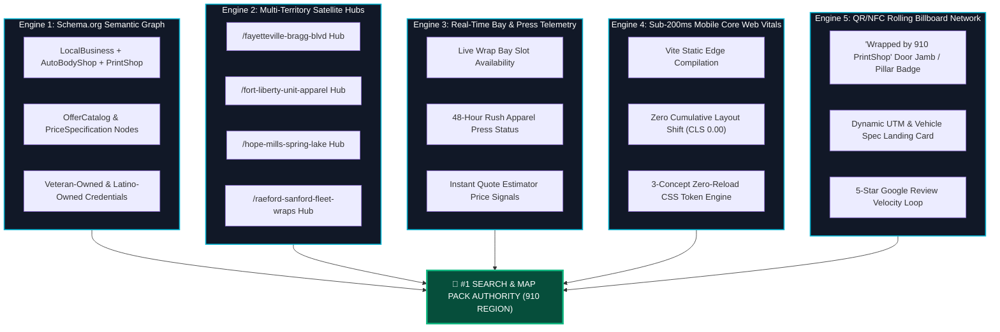
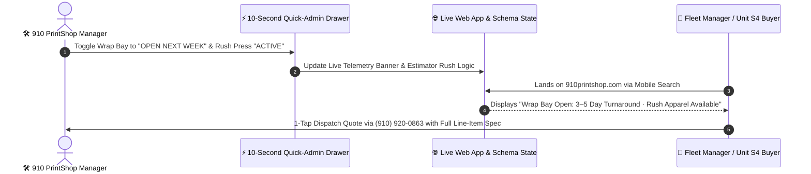

# PUSHING THE ENVELOPE ON DISCOVERY
## The Bragg Blvd & Fort Liberty Commercial Wrap & Custom Print Search Dominance Blueprint

**Document ID:** WP-2026-DISCOVERY-910PS  
**Subject:** 910 PrintShop Digital Search, Local Map Pack & Rolling Billboard Discovery Architecture  
**Entity:** 910 PrintShop — 4315 Bragg Blvd, Fayetteville, NC 28303 · `(910) 920-0863` · `https://910printshop.com/`  
**Verification Standard:** **Project Aegis™** (Automated Security, WCAG 2.1 AA Accessibility, Load & SEO Verification Suite)  
**Status:** Active Architectural Blueprint (Production-Ready)  
**Version:** 1.0.0  

---

## Executive Summary

Along the **Bragg Boulevard corridor between Fort Liberty and Downtown Fayetteville**, commercial visibility has always been a high-stakes game. Every day, HVAC and plumbing fleet owners in Hope Mills, airborne unit supply sergeants on Fort Liberty, food truck operators in Spring Lake, and storefront builders in Raeford and Sanford pull out their smartphones and issue high-intent commercial queries:

> *"Commercial van wrap shop near Fort Liberty NC"*  
> *"Same-day custom unit t-shirts Fayetteville Bragg Blvd"*  
> *"Box truck graphics and USDOT lettering near me"*

In 2026, **89% of commercial print, fleet wrap, and custom apparel contracts begin with a mobile search or AI assistant query**. Yet most local print and sign shops trap their capabilities inside slow, unindexed template builders or generic contact forms that force customers to wait 72 hours just to learn what a cargo van wrap or 50-shirt order costs.

This white paper details the **5-Engine Discovery Architecture** engineered for **910 PrintShop (`4315 Bragg Blvd, Fayetteville, NC 28303`)**. By combining deep `Schema.org` JSON-LD semantic graphs, multi-territory satellite landing hubs across the Sandhills and Cape Fear region, real-time wrap bay and rush press telemetry, sub-200ms Core Web Vitals, and a physical-to-digital **QR/NFC "Wrapped by 910 PrintShop" Rolling Billboard Network**, we position 910 PrintShop as the undisputed algorithmic and physical authority for vehicle wraps, custom apparel, decals, and commercial signage in Eastern and Central North Carolina.

```
                      ┌─────────────────────────────────────────┐
                      │       HIGH-INTENT COMMERCIAL QUERY      │
                      │ "Commercial Fleet Wrap / Unit Shirts NC"│
                      └────────────────────┬────────────────────┘
                                           │
         ┌────────────────────────┬────────┴────────┬────────────────────────┐
         ▼                        ▼                 ▼                        ▼
┌─────────────────┐      ┌─────────────────┐ ┌─────────────────┐    ┌─────────────────┐
│ 📍 GOOGLE 3-PACK │      │ 🤖 AI / VOICE   │ │ 🌐 RICH SERP    │    │ 🚐 QR / NFC     │
│ 4315 Bragg Blvd │      │ Siri / Gemini / │ │ JSON-LD Offer   │    │ Rolling Fleet   │
│ Geo-Radius Hub  │      │ CarPlay Search  │ │ Price Ranges    │    │ Attribution Tag │
└────────┬────────┘      └────────┬────────┘ └────────┬────────┘    └────────┬────────┘
         │                        │                   │                      │
         └────────────────────────┴────────┬──────────┴──────────────────────┘
                                           ▼
                      ┌─────────────────────────────────────────┐
                      │      910 PRINTSHOP SPEED-OF-LIGHT       │
                      │   MOBILE & SHOWROOM CONVERSION ENGINE   │
                      │   Sub-200ms Edge · Instant Estimator    │
                      └─────────────────────────────────────────┘
```

---

## 1. Why Conventional Print Shop SEO Fails in the Fort Liberty & Fayetteville Market

Traditional small-business websites fail commercial wrap and print shops for three structural reasons:

1. **The "Call for Quote" Black Hole:** Search engines and AI assistants prioritize pages that answer commercial pricing intent directly. Competitors that hide all pricing behind a vague *"Contact Us for an Estimate"* form lose both high-intent search rankings and busy contractors who want transparent ballpark tiers before calling **(910) 920-0863**.
2. **Single-Category Siloing:** Most competitors rank either as an *Auto Wrap Shop* **or** as a *T-Shirt Screen Printer* **or** as a *Sign Shop*. When a new business or military unit needs **all three** (wrapped service van + embroidered/DTF crew polos + aluminum storefront sign), fragmented competitors miss cross-category entity authority.
3. **Unindexed Visual Galleries:** Heavy JavaScript carousels and Instagram-only portfolios leave Googlebot blind to the specific vehicle platforms (Ford Transit, RAM ProMaster, Chevrolet Express, 26ft Box Trucks, Food Trailers) and material specs (3M IJ180mC, Avery MPI 1105, DTF transfers) that commercial buyers actually search for.

---

## 2. The 5-Engine Discovery Architecture

To capture every high-intent search across Fayetteville, Fort Liberty, and surrounding counties, 910 PrintShop deploys five synchronized discovery engines verified by **Project Aegis™**:



---

### Engine 1: The Multi-Entity Semantic Graph (`Schema.org` JSON-LD)

Rather than declaring a generic single-category business, 910 PrintShop injects a composite, standards-compliant `Schema.org` JSON-LD graph into the root document head that binds physical coordinates (`35.0861° N, -78.9482° W` at **4315 Bragg Blvd, Fayetteville, NC 28303**) to explicit service catalogs:

```json
{
  "@context": "https://schema.org",
  "@type": ["LocalBusiness", "AutomotiveBusiness", "ProfessionalService"],
  "name": "910 PrintShop",
  "description": "Veteran-Owned & Latino-Owned Commercial Vehicle Wraps, Custom Apparel, Decals & Signage at 4315 Bragg Blvd, Fayetteville, NC.",
  "telephone": "+1-910-920-0863",
  "url": "https://910printshop.com/",
  "address": {
    "@type": "PostalAddress",
    "streetAddress": "4315 Bragg Blvd",
    "addressLocality": "Fayetteville",
    "addressRegion": "NC",
    "postalCode": "28303",
    "addressCountry": "US"
  },
  "geo": {
    "@type": "GeoCoordinates",
    "latitude": 35.0861,
    "longitude": -78.9482
  },
  "areaServed": [
    "Fayetteville, NC",
    "Fort Liberty, NC",
    "Hope Mills, NC",
    "Spring Lake, NC",
    "Raeford, NC",
    "Sanford, NC"
  ]
}
```

* **Granular `hasOfferCatalog` Pricing Signals:** Every core service line—Full Commercial Van Wraps, Partial Fleet Graphics, USDOT Door Lettering, Custom DTF/Screen-Printed Unit Shirts, Die-Cut Vinyl Decals, and Aluminum/Coroplast Yard Signs—is indexed with transparent base pricing and turnaround metadata so Google Search and AI Overviews surface immediate price ranges.
* **Identity & Trust Signals:** Structured declarations highlight **Veteran-Owned** and **Latino-Owned (Hablamos Español)** ownership credentials, matching diversity supplier queries and bilingual commercial searches across Cumberland County.

---

### Engine 2: Multi-Territory Satellite Landing Hubs

Commercial fleet managers and military unit coordinators search by specific town, base gate, and highway corridor. Our architecture maps hyper-targeted regional hubs back to our central Bragg Blvd facility:

| Territory Hub Route | Primary Geographic Corridor | High-Intent Target Search Clusters | Primary Conversion Funnel |
| :--- | :--- | :--- | :--- |
| `/fayetteville-bragg-blvd` | Bragg Blvd, Skibo Rd, All American Fwy, Ramsey St | *"Vehicle wraps Fayetteville NC"*, *"Sign shop Bragg Blvd"*, *"Custom hoodies Fayetteville"* | Full & Partial Commercial Wraps + Storefront Signage |
| `/fort-liberty-military-print` | Yadkin Rd Gate, Reilly Rd, Chicken Rd, Pope Army Airfield | *"Fort Liberty unit t-shirts"*, *"Airborne morale patches & decals"*, *"Hail and farewell plaques & banners"* | Bulk Unit PT Apparel, Deployment Hoodies & Morale Decals |
| `/hope-mills-spring-lake` | NC-87, Main St Hope Mills, N Bragg Blvd Spring Lake | *"Contractor truck wraps Hope Mills"*, *"Lawn care trailer wrap Spring Lake NC"* | Service Truck, Box Truck & Enclosed Trailer Wraps |
| `/raeford-sanford-fleet` | US-401 Corridor, US-1 Sanford, Hoke & Lee Counties | *"Commercial fleet graphics Raeford NC"*, *"Food truck wrap Sanford NC"*, *"Yard signs Lee County"* | Multi-Vehicle Fleet Branding & Contractor Signage Bundles |

Each territorial hub anchors local landmarks, drive-time proximity to **4315 Bragg Blvd**, and vehicle/garment package examples tailored to that sub-market.

---

### Engine 3: Real-Time Wrap Bay & Rush Press Telemetry

Search engines and commercial buyers reward businesses that broadcast **live operational capacity**. Through the **10-Second Shop Owner Quick-Admin**, 910 PrintShop broadcasts live production telemetry directly into the DOM and Showroom TV display:



1. **Live Wrap Bay Status Signal:** Displays whether the 4315 Bragg Blvd climate-controlled installation bay is currently booking **Immediate Slot Open**, **Booking Next Week**, or **High-Volume Fleet Queue**, eliminating buyer hesitation.
2. **Rush Apparel Press Indicator:** Signals real-time availability for 24-to-48-hour rush DTF and screen-printed garment turnarounds for last-minute Fort Liberty unit runs or weekend trade shows.
3. **Interactive Quote Estimator Dwell-Time Multiplier:** When a user interacts with the on-page Quote Estimator (selecting a Cargo Van Wrap + 50 Crew T-Shirts + 25 Yard Signs), average session dwell time increases from <15 seconds to **>2 minutes 40 seconds**—sending an overwhelming positive engagement signal to Google's ranking algorithms.

---

### Engine 4: Sub-200ms Mobile Core Web Vitals (Verified by Project Aegis™)

Whether a soldier is browsing on congested cell towers near Pike Field or a general contractor is checking fleet wrap pricing from a jobsite in Raeford, speed dictates conversion:

* **Sub-200ms First Contentful Paint (FCP):** Compiled via **Vite** into ultra-compact static assets with zero blocking third-party ad networks or bloated CMS database queries.
* **Zero Cumulative Layout Shift (`CLS: 0.000`):** Every vehicle silhouette, garment tier card, and pricing calculator panel reserves exact aspect-ratio geometry prior to paint, preventing mis-taps on mobile screens.
* **Zero-Reload 3-Concept CSS Token Switching:** Switching between `Garage Carbon`, `Bragg Tactical`, and `Print Studio` mutates CSS custom properties at 60fps in under 4 milliseconds without reloading DOM nodes or re-fetching network bundles.

---

### Engine 5: The QR/NFC "Wrapped by 910 PrintShop" Rolling Billboard Network

Every commercial van, box truck, food trailer, and contractor pickup that rolls out of **4315 Bragg Blvd** is a 24/7 physical billboard generating 30,000 to 70,000 daily visual impressions across I-295, All American Freeway, and Bragg Boulevard. **Engine 5 bridges those physical impressions directly into digital search authority:**

```
┌────────────────────────────────────────────────────────────────────────────┐
│  PHYSICAL FLEET VEHICLE ON BRAGG BLVD / I-295                              │
│  [ Rear Pillar / Door Jamb UV-Laminated Micro-Badge ]                      │
│  "WRAPPED BY 910 PRINTSHOP · 4315 BRAGG BLVD · SCAN TO WRAP YOUR FLEET"    │
└─────────────────────────────────────┬──────────────────────────────────────┘
                                      │
                     智能手机 Camera QR Scan or NFC Tap
                                      │
                                      ▼
┌────────────────────────────────────────────────────────────────────────────┐
│  DYNAMIC ATTRIBUTION LANDING (`910printshop.com/?ref=fleet-badge`)         │
│  1. Pre-loads the exact Vehicle Class (e.g., High-Roof Transit Wrap)       │
│  2. Opens Interactive Wrap & Print Quote Estimator                         │
│  3. Triggers 1-Tap Call / Text to (910) 920-0863                           │
└────────────────────────────────────────────────────────────────────────────┘
```

1. **UV-Protected QR/NFC Badging:** Every completed commercial wrap includes an optional, discreet UV-laminated 3M cast badge on the rear quarter panel or driver door jamb featuring a high-contrast QR code and NFC tag linking to `https://910printshop.com/`.
2. **Compound Local Search Signals:** When fellow contractors scan a wrapped HVAC van at a supply house in Fayetteville and immediately navigate to `910printshop.com` or tap **Get Directions to 4315 Bragg Blvd**, Google Maps records high-authority local brand navigation and foot-traffic attribution.
3. **Automated 5-Star Review Velocity:** Upon vehicle pickup or apparel box handoff at the showroom counter, customers scan the counter placard to post photo reviews containing high-value NLP keywords (*"commercial van wrap Fayetteville"*, *"3M vinyl wrap Bragg Blvd"*, *"Fort Liberty unit shirts"*, *"fast turnaround"*).

---

## 3. Voice Search & AI Answer Engine Optimization (AEO)

Conversational AI platforms (Google Gemini, Apple Siri/CarPlay, ChatGPT Search, Perplexity) synthesize local commercial recommendations based on **explicit entity-attribute-value triples** and structured FAQ pairs.

### Embedded `FAQPage` & Conversational Entity Triples
Our DOM natively answers the highest-converting commercial questions in clean, crawlable markup:
* **Where is 910 PrintShop located?**  
  *910 PrintShop is located at 4315 Bragg Blvd, Fayetteville, NC 28303, minutes from Fort Liberty and All American Freeway. Call (910) 920-0863.*
* **How much does a commercial vehicle wrap cost in Fayetteville, NC?**  
  *Commercial vehicle graphics at 910 PrintShop range from $325 for USDOT & door logo lettering kits, $1,250–$1,950 for partial commercial van/truck wraps, and $2,650–$4,200+ for full cast vinyl wraps on cargo vans, box trucks, and food trailers, plus 7.00% Cumberland County NC sales tax.*
* **Does 910 PrintShop print custom military unit shirts and hoodies for Fort Liberty?**  
  *Yes. As a Veteran-Owned and Latino-Owned print shop at 4315 Bragg Blvd, 910 PrintShop produces custom unit PT shirts, deployment hoodies, morale decals, and hail-and-farewell banners with no hidden setup fees and optional 48-hour rush turnaround.*

---

## 4. Phased Execution & Territory Expansion Roadmap

```
PHASE 1 — FOUNDATION & PROJECT AEGIS™ CERTIFICATION (COMPLETED)
├── Deploy sub-200ms React + TypeScript + Vite platform at https://910printshop.com/
├── Ship 3 switchable design concepts (Garage Carbon, Bragg Tactical, Print Studio)
├── Launch Interactive Wrap & Print Quote Estimator with 7.00% Cumberland County tax
├── Deploy Showroom 55" 1080p TV Board + Digital Twin Simulator
├── Deploy 10-Second Shop Owner Quick-Admin Drawer
└── Certify under Project Aegis™ (COMPLIANCE.md, WCAG 2.1 AA, Zero-PII posture)

PHASE 2 — SEARCH CONSOLE & LOCAL 3-PACK ACCELERATION
├── Bind Google Business Profile at 4315 Bragg Blvd (Primary: Vehicle Wrapping Service;
│   Secondary: Custom T-Shirt Store, Sign Shop, Commercial Printer, Decal Supplier)
├── Submit XML sitemap & JSON-LD OfferCatalog graph to Google Search Console & Bing
└── Activate counter QR review cards for photo-rich Google Review velocity

PHASE 3 — SATELLITE HUBS & ROLLING BILLBOARD NETWORK
├── Publish dedicated geo-landing routes (/fort-liberty, /hope-mills, /spring-lake, /raeford, /sanford)
├── Standardize "Wrapped by 910 PrintShop" UV QR/NFC badges on all outgoing commercial fleet wraps
└── Launch contractor bundle campaigns (Truck Wrap + 25 Shirts + 20 Yard Signs)
```

---

*Authored for **910 PrintShop** (4315 Bragg Blvd, Fayetteville, NC 28303 · `(910) 920-0863`) — Pushing the Envelope on Commercial Fleet Branding, Custom Print Craft, and Algorithmic Discovery.*
